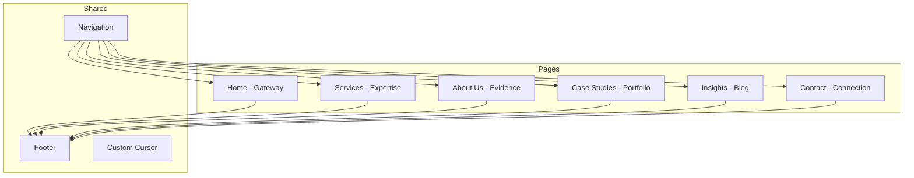
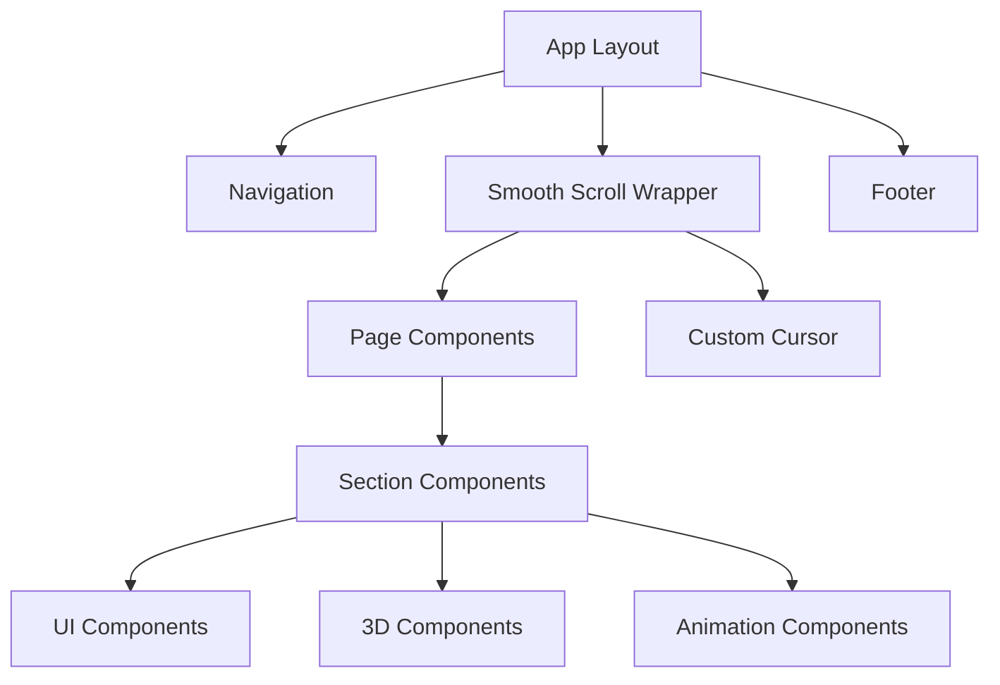
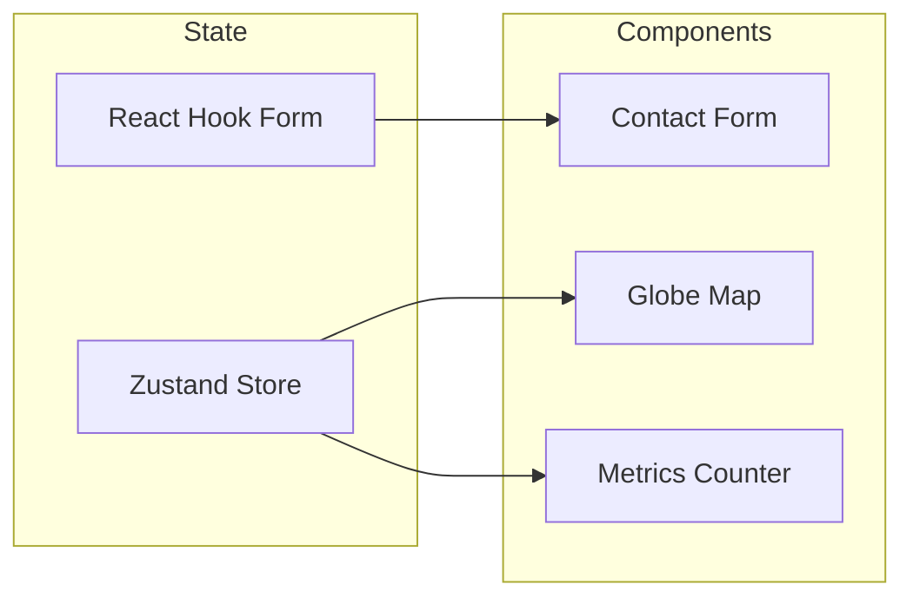

# Contact2Hire - Modern Responsive React Website Architecture

## Project Overview

**Company:** Contact to Hire  
**Domain:** contacttohire.in  
**Tagline:** Connecting Talents  
**Location:** Ahmedabad, Gujarat, India  
**Target Market:** India to EMEA recruitment bridge  

---

## 1. Tech Stack

### Core Framework
- **Next.js 14** - App Router with SSR/SSG for optimal SEO
- **TypeScript** - Type-safe development
- **React 18** - Latest React features

### Animation & Interaction
- **GSAP 3** - ScrollTrigger, ScrollSmoother, Timeline animations
- **Lenis** - Smooth scroll implementation
- **Framer Motion** - React-friendly micro-interactions

### 3D & Graphics
- **React Three Fiber** - Three.js React renderer
- **@react-three/drei** - Helper components for R3F
- **@react-three/postprocessing** - Visual effects

### Styling
- **Tailwind CSS** - Utility-first CSS
- **CSS Modules** - Component-scoped styles
- **CSS Variables** - Design tokens

### State & Data
- **Zustand** - Lightweight state management
- **React Hook Form** - Form handling
- **Zod** - Schema validation

### Performance & SEO
- **next/image** - Optimized images
- **next/font** - Font optimization
- **next-seo** - SEO meta management

---

## 2. Project Structure

```
contact2hire/
├── app/                          # Next.js App Router
│   ├── layout.tsx               # Root layout
│   ├── page.tsx                 # Home (Gateway)
│   ├── services/
│   │   └── page.tsx             # Services (Expertise)
│   ├── about/
│   │   └── page.tsx             # About Us (Evidence)
│   ├── case-studies/
│   │   ├── page.tsx             # Portfolio overview
│   │   └── [slug]/
│   │       └── page.tsx         # Individual case study
│   ├── insights/
│   │   ├── page.tsx             # Blog listing
│   │   └── [slug]/
│   │       └── page.tsx         # Individual article
│   ├── contact/
│   │   └── page.tsx             # Contact (Connection)
│   ├── privacy/
│   │   └── page.tsx             # Privacy Policy
│   └── terms/
│       └── page.tsx             # Terms of Service
│
├── components/
│   ├── ui/                      # Base UI components
│   │   ├── Button/
│   │   ├── Badge/
│   │   ├── Card/
│   │   ├── Input/
│   │   ├── Link/
│   │   └── ...
│   │
│   ├── layout/                  # Layout components
│   │   ├── Navigation/
│   │   ├── Footer/
│   │   ├── Cursor/
│   │   └── Loader/
│   │
│   ├── sections/                # Page sections
│   │   ├── Hero/
│   │   ├── Metrics/
│   │   ├── Timeline/
│   │   ├── WorldMap/
│   │   ├── ContactForm/
│   │   └── ...
│   │
│   ├── three/                   # 3D components
│   │   ├── HeroScene/
│   │   ├── GlobeMap/
│   │   ├── FloatingElements/
│   │   └── ...
│   │
│   └── animations/              # Animation components
│       ├── ScrollReveal/
│       ├── ParallaxSection/
│       ├── TextReveal/
│       └── ...
│
├── hooks/                       # Custom hooks
│   ├── useScrollTrigger.ts
│   ├── useSmoothScroll.ts
│   ├── useCursor.ts
│   └── ...
│
├── lib/                         # Utilities
│   ├── gsap.ts                 # GSAP configuration
│   ├── utils.ts                # Helper functions
│   └── constants.ts            # App constants
│
├── styles/
│   ├── globals.css             # Global styles
│   └── variables.css           # CSS custom properties
│
├── public/
│   ├── fonts/                  # Self-hosted fonts
│   ├── images/                 # Static images
│   ├── models/                 # 3D models
│   └── textures/               # 3D textures
│
└── types/                       # TypeScript types
    └── index.ts
```

---

## 3. Design System

### 3.1 Color Palette - Warm Organic

```css
:root {
  /* Base Colors */
  --color-cream: #FDF8F0;
  --color-cream-dark: #F5EDE0;
  
  /* Primary */
  --color-brown: #3C2415;
  --color-brown-light: #5A3D2B;
  
  /* Accent Colors - Adapted for EMEA Corporate */
  --color-emerald: #0F5132;
  --color-emerald-light: #1A7A4C;
  --color-royal-blue: #1E3A8A;
  --color-royal-blue-light: #3B5998;
  
  /* Secondary Accents */
  --color-sun-yellow: #F4B942;
  --color-terracotta: #C75B39;
  --color-soft-orange: #E07B39;
  
  /* Neutrals */
  --color-white: #FFFFFF;
  --color-gray-100: #F8F6F3;
  --color-gray-200: #E8E4DE;
  --color-gray-300: #D1CBC2;
  --color-gray-400: #A69F94;
  --color-gray-500: #736E66;
  
  /* Semantic */
  --color-success: #2D7A4F;
  --color-error: #C73E3E;
  --color-warning: #D4A017;
}
```

### 3.2 Typography

```css
:root {
  /* Display Font - Modern Serif */
  --font-display: 'Playfair Display', Georgia, serif;
  
  /* Body Font - Geometric Sans */
  --font-body: 'Inter', system-ui, sans-serif;
  
  /* Font Sizes - Fluid Typography */
  --text-xs: clamp(0.75rem, 0.7rem + 0.25vw, 0.875rem);
  --text-sm: clamp(0.875rem, 0.8rem + 0.375vw, 1rem);
  --text-base: clamp(1rem, 0.9rem + 0.5vw, 1.125rem);
  --text-lg: clamp(1.125rem, 1rem + 0.625vw, 1.25rem);
  --text-xl: clamp(1.25rem, 1.1rem + 0.75vw, 1.5rem);
  --text-2xl: clamp(1.5rem, 1.25rem + 1.25vw, 2rem);
  --text-3xl: clamp(1.875rem, 1.5rem + 1.875vw, 2.5rem);
  --text-4xl: clamp(2.25rem, 1.75rem + 2.5vw, 3rem);
  --text-5xl: clamp(3rem, 2rem + 5vw, 4.5rem);
  --text-6xl: clamp(3.75rem, 2.5rem + 6.25vw, 6rem);
  --text-hero: clamp(4rem, 2.5rem + 7.5vw, 8rem);
  
  /* Line Heights */
  --leading-tight: 0.9;
  --leading-snug: 1.1;
  --leading-normal: 1.5;
  --leading-relaxed: 1.75;
  
  /* Letter Spacing */
  --tracking-tighter: -0.05em;
  --tracking-tight: -0.025em;
  --tracking-normal: 0;
  --tracking-wide: 0.025em;
  --tracking-wider: 0.05em;
  --tracking-widest: 0.1em;
}
```

### 3.3 Spacing & Layout

```css
:root {
  /* Spacing Scale */
  --space-1: 0.25rem;
  --space-2: 0.5rem;
  --space-3: 0.75rem;
  --space-4: 1rem;
  --space-5: 1.25rem;
  --space-6: 1.5rem;
  --space-8: 2rem;
  --space-10: 2.5rem;
  --space-12: 3rem;
  --space-16: 4rem;
  --space-20: 5rem;
  --space-24: 6rem;
  --space-32: 8rem;
  --space-40: 10rem;
  --space-48: 12rem;
  
  /* Container */
  --container-max: 1440px;
  --container-padding: clamp(1rem, 5vw, 4rem);
  
  /* Border Radius */
  --radius-sm: 0.25rem;
  --radius-md: 0.5rem;
  --radius-lg: 1rem;
  --radius-xl: 1.5rem;
  --radius-2xl: 2rem;
  --radius-full: 9999px;
  
  /* Shadows */
  --shadow-sm: 0 1px 2px rgba(60, 36, 21, 0.05);
  --shadow-md: 0 4px 6px rgba(60, 36, 21, 0.07);
  --shadow-lg: 0 10px 15px rgba(60, 36, 21, 0.1);
  --shadow-xl: 0 20px 25px rgba(60, 36, 21, 0.12);
  
  /* Transitions */
  --transition-fast: 150ms ease;
  --transition-base: 300ms ease;
  --transition-slow: 500ms ease;
  --transition-slower: 700ms ease;
}
```

---

## 4. Page Architecture

### 4.1 Home (Gateway)

```
┌─────────────────────────────────────────────────────────────┐
│  [Navigation - Ghost/Minimalist]                             │
├─────────────────────────────────────────────────────────────┤
│                                                             │
│  ┌─────────────────────────────────────────────────────┐   │
│  │  HERO SECTION                                        │   │
│  │  ┌─────────────────────────────────────────────┐    │   │
│  │  │  3D Scene: India-EMEA Connection            │    │   │
│  │  │  - Animated particles flowing between       │    │   │
│  │  │    two glowing orbs (India & EMEA)          │    │   │
│  │  │  - Subtle parallax on mouse move            │    │   │
│  │  └─────────────────────────────────────────────┘    │   │
│  │                                                     │   │
│  │  CONNECTING         ← Oversized Serif              │   │
│  │  TALENTS            ← Split animation              │   │
│  │                                                     │   │
│  │  Bridging India's finest talent                    │   │
│  │  with EMEA opportunities                           │   │
│  │                                                     │   │
│  │  [Explore Opportunities →]  [Hire Talent →]        │   │
│  └─────────────────────────────────────────────────────┘   │
│                                                             │
├─────────────────────────────────────────────────────────────┤
│                                                             │
│  METRICS SECTION                                            │
│  ┌────────────┐ ┌────────────┐ ┌────────────┐             │
│  │ 1,500+     │ │ 300+       │ │ 5+         │             │
│  │ Placements │ │ Clients    │ │ Years      │             │
│  │ [Counter]  │ │ [Counter]  │ │ [Counter]  │             │
│  └────────────┘ └────────────┘ └────────────┘             │
│                                                             │
├─────────────────────────────────────────────────────────────┤
│                                                             │
│  NARRATIVE SECTION                                          │
│  ┌─────────────────────────────────────────────────────┐   │
│  │  "We don't just find jobs.                          │   │
│  │   We architect careers and build teams."            │   │
│  │                                                     │   │
│  │  Our 5-year legacy of precision hiring,             │   │
│  │  connecting India's top talent with EMEA's          │   │
│  │  most ambitious companies.                          │   │
│  └─────────────────────────────────────────────────────┘   │
│                                                             │
├─────────────────────────────────────────────────────────────┤
│                                                             │
│  FEATURED SECTORS - Bento Grid                              │
│  ┌──────────────┐ ┌──────────┐ ┌──────────┐               │
│  │              │ │          │ │          │               │
│  │   TECHNOLOGY │ │ FINANCE  │ HEALTHCARE│               │
│  │   [Large]    │ │ [Small]  │ │ [Small]  │               │
│  │   Hover:     │ │          │ │          │               │
│  │   Reveal IMG │ │          │ │          │               │
│  └──────────────┘ └──────────┴──────────┘               │
│  ┌──────────┐ ┌──────────────────────────────┐           │
│  │ MANUFAC- │ │        ENERGY & OIL          │           │
│  │ TURING   │ │        [Wide]                │           │
│  └──────────┘ └──────────────────────────────┘           │
│                                                             │
├─────────────────────────────────────────────────────────────┤
│                                                             │
│  CLIENT LOGOS - Marquee Scroll                              │
│  [Logo] [Logo] [Logo] [Logo] [Logo] [Logo] [Logo]          │
│  ← ← ← ← ← ← ← ← ← ← ← ← ← ← ← ← ← ← ← ← ← ←              │
│                                                             │
├─────────────────────────────────────────────────────────────┤
│                                                             │
│  CTA SECTION                                                │
│  ┌─────────────────────────────────────────────────────┐   │
│  │  Ready to build your dream team?                    │   │
│  │  [Start Hiring Today →]                             │   │
│  └─────────────────────────────────────────────────────┘   │
│                                                             │
└─────────────────────────────────────────────────────────────┘
```

### 4.2 Services (Expertise)

```
┌─────────────────────────────────────────────────────────────┐
│  [Navigation]                                               │
├─────────────────────────────────────────────────────────────┤
│                                                             │
│  HERO                                                       │
│  OUR EXPERTISE                                              │
│  Specialized recruitment solutions for the                  │
│  India-EMEA corridor                                        │
│                                                             │
├─────────────────────────────────────────────────────────────┤
│                                                             │
│  SERVICE CARDS - Horizontal Scroll Section                  │
│  ┌─────────────────────────────────────────────────────┐   │
│  │  ← Scroll Horizontally →                            │   │
│  │                                                     │   │
│  │  ┌─────────┐ ┌─────────┐ ┌─────────┐ ┌─────────┐  │   │
│  │  │ EMEA    │ │EXECUTIVE│ │  RPO    │ │CANDIDATE│  │   │
│  │  │ SPECIAL-│ │ SEARCH  │ │         │ │ CURATING│  │   │
│  │  │ IZATION │ │         │ │         │ │         │  │   │
│  │  │         │ │         │ │         │ │         │  │   │
│  │  │ Deep    │ │ White-  │ │ Scale-up│ │Quality  │  │   │
│  │  │ dive... │ │ glove...│ │solutions│ │over...  │  │   │
│  │  └─────────┘ └─────────┘ └─────────┘ └─────────┘  │   │
│  │                                                     │   │
│  └─────────────────────────────────────────────────────┘   │
│                                                             │
├─────────────────────────────────────────────────────────────┤
│                                                             │
│  PROCESS SECTION                                            │
│  How We Work                                                │
│                                                             │
│  01 ─── 02 ─── 03 ─── 04                                   │
│  Discover → Source → Vet → Place                            │
│                                                             │
├─────────────────────────────────────────────────────────────┤
│                                                             │
│  EMEA DEEP DIVE                                             │
│  ┌─────────────────────────────────────────────────────┐   │
│  │  Interactive accordion showing:                      │   │
│  │  - European Labor Laws                               │   │
│  │  - Middle Eastern Work Culture                       │   │
│  │  - Visa & Relocation Support                         │   │
│  │  - Cultural Integration                              │   │
│  └─────────────────────────────────────────────────────┘   │
│                                                             │
└─────────────────────────────────────────────────────────────┘
```

### 4.3 About Us (Evidence)

```
┌─────────────────────────────────────────────────────────────┐
│  [Navigation]                                               │
├─────────────────────────────────────────────────────────────┤
│                                                             │
│  HERO                                                       │
│  OUR STORY                                                  │
│  5+ years of bridging talent across continents              │
│                                                             │
├─────────────────────────────────────────────────────────────┤
│                                                             │
│  TIMELINE - Scroll Triggered                                │
│  ┌─────────────────────────────────────────────────────┐   │
│  │                                                     │   │
│  │  2019 ──●                                           │   │
│  │         │ Founded in Ahmedabad                      │   │
│  │         │ First EMEA placement                      │   │
│  │                                                     │   │
│  │  2020 ──●                                           │   │
│  │         │ Expanded to Dubai market                  │   │
│  │                                                     │   │
│  │  2021 ──●                                           │   │
│  │         │ 500+ placements milestone                 │   │
│  │                                                     │   │
│  │  2022 ──●                                           │   │
│  │         │ London office partnership                 │   │
│  │                                                     │   │
│  │  2023 ──●                                           │   │
│  │         │ 1000+ placements                          │   │
│  │                                                     │   │
│  │  2024 ──●                                           │   │
│  │         │ 1500+ placements, 300+ clients            │   │
│  │                                                     │   │
│  └─────────────────────────────────────────────────────┘   │
│                                                             │
├─────────────────────────────────────────────────────────────┤
│                                                             │
│  INDIA ADVANTAGE                                            │
│  ┌───────────────────┐ ┌───────────────────┐               │
│  │                   │ │                   │               │
│  │  Why India?       │ │  Our Advantage    │               │
│  │  - Large talent   │ │  - Cost-effective │               │
│  │    pool           │ │  - English prof.  │               │
│  │  - Tech hub       │ │  - Cultural fit   │               │
│  │                   │ │                   │               │
│  └───────────────────┘ └───────────────────┘               │
│                                                             │
├─────────────────────────────────────────────────────────────┤
│                                                             │
│  CORE VALUES                                                │
│  ┌──────┐ ┌──────┐ ┌──────┐ ┌──────┐                      │
│  │ 🎯   │ │ ⚡   │ │ 🤝   │ │ 🌍   │                      │
│  │Precision│Speed │Integrity│Diversity│                   │
│  └──────┘ └──────┘ └──────┘ └──────┘                      │
│                                                             │
├─────────────────────────────────────────────────────────────┤
│                                                             │
│  MEET THE CURATORS                                          │
│  ┌─────────────────────────────────────────────────────┐   │
│  │  High-fashion style portraits                       │   │
│  │  ┌─────────┐ ┌─────────┐ ┌─────────┐              │   │
│  │  │ [Photo] │ │ [Photo] │ │ [Photo] │              │   │
│  │  │  Name   │ │  Name   │ │  Name   │              │   │
│  │  │  Title  │ │  Title  │ │  Title  │              │   │
│  │  └─────────┘ └─────────┘ └─────────┘              │   │
│  └─────────────────────────────────────────────────────┘   │
│                                                             │
└─────────────────────────────────────────────────────────────┘
```

### 4.4 Case Studies (Portfolio)

```
┌─────────────────────────────────────────────────────────────┐
│  [Navigation]                                               │
├─────────────────────────────────────────────────────────────┤
│                                                             │
│  HERO                                                       │
│  SUCCESS STORIES                                            │
│  Real results for real companies                            │
│                                                             │
├─────────────────────────────────────────────────────────────┤
│                                                             │
│  GLOBAL FOOTPRINT MAP - WebGL Interactive                   │
│  ┌─────────────────────────────────────────────────────┐   │
│  │                                                     │   │
│  │     [3D Globe with animated arcs]                   │   │
│  │                                                     │   │
│  │  India ────────→ Dubai                              │   │
│  │     │                                               │   │
│  │     └──────────→ London                             │   │
│  │     │                                               │   │
│  │     └──────────→ Berlin                             │   │
│  │                                                     │   │
│  │  [Click city to see placements]                     │   │
│  │                                                     │   │
│  └─────────────────────────────────────────────────────┘   │
│                                                             │
├─────────────────────────────────────────────────────────────┤
│                                                             │
│  CASE STUDY GRID - Modular Bento                            │
│  ┌──────────────────────┐ ┌──────────────┐                 │
│  │                      │ │              │                 │
│  │  London Tech Firm    │ │ Dubai Congl- │                 │
│  │  50+ roles filled    │ │ omerate      │                 │
│  │  in 6 months         │ │ 30+ execs    │                 │
│  │  [Large Card]        │ │ [Small]      │                 │
│  │                      │ │              │                 │
│  └──────────────────────┘ └──────────────┘                 │
│  ┌──────────────┐ ┌──────────────┐ ┌──────────┐           │
│  │ German       │ │ Saudi        │ │ Qatar    │           │
│  │ Healthcare   │ │ Aramco       │ │ Bank     │           │
│  └──────────────┘ └──────────────┘ └──────────┘           │
│                                                             │
├─────────────────────────────────────────────────────────────┤
│                                                             │
│  TESTIMONIALS                                               │
│  "Contact2Hire transformed our hiring process..."           │
│  - CEO, London Tech Startup                                 │
│                                                             │
└─────────────────────────────────────────────────────────────┘
```

### 4.5 Insights (Blog)

```
┌─────────────────────────────────────────────────────────────┐
│  [Navigation]                                               │
├─────────────────────────────────────────────────────────────┤
│                                                             │
│  HERO                                                       │
│  INSIGHTS & RESOURCES                                       │
│                                                             │
├─────────────────────────────────────────────────────────────┤
│                                                             │
│  FEATURED ARTICLE                                           │
│  ┌─────────────────────────────────────────────────────┐   │
│  │  [Large featured article card]                       │   │
│  │  EMEA Hiring Trends 2024                             │   │
│  └─────────────────────────────────────────────────────┘   │
│                                                             │
├─────────────────────────────────────────────────────────────┤
│                                                             │
│  CATEGORIES                                                 │
│  [All] [Market Reports] [Relocation Guides] [Career Tips]  │
│                                                             │
├─────────────────────────────────────────────────────────────┤
│                                                             │
│  ARTICLE GRID                                               │
│  ┌──────────────┐ ┌──────────────┐ ┌──────────────┐       │
│  │ Moving to    │ │ Dubai Job    │ │ UK Work Visa │       │
│  │ Dubai: Guide │ │ Market 2024  │ │ Complete     │       │
│  └──────────────┘ └──────────────┘ └──────────────┘       │
│  ┌──────────────┐ ┌──────────────┐ ┌──────────────┐       │
│  │ Tech Salaries│ │ Interview    │ │ Cultural     │       │
│  │ EMEA vs India│ │ Tips for EMEA│ │ Integration  │       │
│  └──────────────┘ └──────────────┘ └──────────────┘       │
│                                                             │
└─────────────────────────────────────────────────────────────┘
```

### 4.6 Contact (Connection)

```
┌─────────────────────────────────────────────────────────────┐
│  [Navigation]                                               │
├─────────────────────────────────────────────────────────────┤
│                                                             │
│  HERO                                                       │
│  LET'S CONNECT                                              │
│  Your next great hire or career move starts here            │
│                                                             │
├─────────────────────────────────────────────────────────────┤
│                                                             │
│  DUAL FORM SECTION                                          │
│  ┌─────────────────────────┐ ┌─────────────────────────┐   │
│  │  I'M LOOKING FOR        │ │  I'M LOOKING FOR        │   │
│  │  TALENT                 │ │  A CAREER               │   │
│  │                         │ │                         │   │
│  │  Company Name           │ │  Full Name              │   │
│  │  Contact Person         │ │  Email                  │   │
│  │  Email                  │ │  Phone                  │   │
│  │  Phone                  │ │  Current Role           │   │
│  │  Roles Needed           │ │  Desired Location       │   │
│  │  [Submit]               │ │  Resume Upload          │   │
│  │                         │ │  [Submit]               │   │
│  └─────────────────────────┘ └─────────────────────────┘   │
│                                                             │
├─────────────────────────────────────────────────────────────┤
│                                                             │
│  GLOBAL CLOCK                                               │
│  ┌─────────────────────────────────────────────────────┐   │
│  │  🇮🇳 Ahmedabad    │  🇦🇪 Dubai      │  🇬🇧 London   │   │
│  │  IST 14:30       │  GST 13:00     │  GMT 09:00    │   │
│  └─────────────────────────────────────────────────────┘   │
│                                                             │
├─────────────────────────────────────────────────────────────┤
│                                                             │
│  CONTACT INFO                                               │
│  ┌─────────────────────────────────────────────────────┐   │
│  │  Address:                                           │   │
│  │  D-13, Dhusali Society, Talavadi,                   │   │
│  │  Nr-Hansol police chowky, Airport Road,             │   │
│  │  Ahmedabad – 382475, Gujarat – INDIA                │   │
│  │                                                     │   │
│  │  Phone: +91-9601570167                              │   │
│  │  Email: info@contacttohire.in                       │   │
│  └─────────────────────────────────────────────────────┘   │
│                                                             │
└─────────────────────────────────────────────────────────────┘
```

---

## 5. Animation Strategy

### 5.1 GSAP Animations

```typescript
// Core Animation Patterns

// 1. Hero Text Reveal
const heroReveal = gsap.timeline();
heroReveal
  .from('.hero-title span', {
    y: 100,
    opacity: 0,
    duration: 1.2,
    stagger: 0.1,
    ease: 'power4.out'
  });

// 2. Scroll-Triggered Sections
gsap.registerPlugin(ScrollTrigger);

gsap.utils.toArray('.reveal-section').forEach((section) => {
  gsap.from(section, {
    scrollTrigger: {
      trigger: section,
      start: 'top 80%',
      end: 'bottom 20%',
      toggleActions: 'play none none reverse'
    },
    y: 60,
    opacity: 0,
    duration: 1,
    ease: 'power3.out'
  });
});

// 3. Horizontal Scroll Section
const horizontalScroll = gsap.to('.services-track', {
  x: () => -(document.querySelector('.services-track').scrollWidth - window.innerWidth),
  ease: 'none',
  scrollTrigger: {
    trigger: '.services-container',
    start: 'top top',
    end: () => '+=' + document.querySelector('.services-track').scrollWidth,
    scrub: 1,
    pin: true,
    anticipatePin: 1
  }
});

// 4. Counter Animation
const animateCounter = (element, target) => {
  gsap.to(element, {
    textContent: target,
    duration: 2,
    ease: 'power1.inOut',
    snap: { textContent: 1 },
    scrollTrigger: {
      trigger: element,
      start: 'top 80%'
    }
  });
};

// 5. Parallax Background
gsap.utils.toArray('.parallax-bg').forEach(bg => {
  gsap.to(bg, {
    yPercent: -30,
    ease: 'none',
    scrollTrigger: {
      trigger: bg.parentElement,
      start: 'top bottom',
      end: 'bottom top',
      scrub: true
    }
  });
});
```

### 5.2 Micro-Interactions

```typescript
// Custom Cursor
const useCustomCursor = () => {
  const cursorRef = useRef(null);
  
  useEffect(() => {
    const cursor = cursorRef.current;
    
    const moveCursor = (e) => {
      gsap.to(cursor, {
        x: e.clientX,
        y: e.clientY,
        duration: 0.3,
        ease: 'power2.out'
      });
    };
    
    const handleHover = () => {
      gsap.to(cursor, { scale: 2, duration: 0.3 });
    };
    
    const handleLeave = () => {
      gsap.to(cursor, { scale: 1, duration: 0.3 });
    };
    
    window.addEventListener('mousemove', moveCursor);
    
    document.querySelectorAll('a, button').forEach(el => {
      el.addEventListener('mouseenter', handleHover);
      el.addEventListener('mouseleave', handleLeave);
    });
    
    return () => {
      window.removeEventListener('mousemove', moveCursor);
    };
  }, []);
  
  return cursorRef;
};
```

---

## 6. 3D Implementation

### 6.1 Hero Scene (React Three Fiber)

```tsx
// components/three/HeroScene.tsx
import { Canvas, useFrame } from '@react-three/fiber';
import { Float, Sphere, Trail } from '@react-three/drei';
import * as THREE from 'three';

const ParticleFlow = () => {
  const particles = useRef();
  
  useFrame((state) => {
    // Animate particles flowing between India and EMEA
    const time = state.clock.getElapsedTime();
    // Particle animation logic
  });
  
  return (
    <group>
      {/* India Orb */}
      <Sphere position={[-3, 0, 0]} args={[0.5, 32, 32]}>
        <meshStandardMaterial color="#0F5132" emissive="#0F5132" emissiveIntensity={0.5} />
      </Sphere>
      
      {/* EMEA Orb */}
      <Sphere position={[3, 0, 0]} args={[0.5, 32, 32]}>
        <meshStandardMaterial color="#1E3A8A" emissive="#1E3A8A" emissiveIntensity={0.5} />
      </Sphere>
      
      {/* Flowing Particles */}
      <Trail
        width={0.5}
        length={8}
        color="#F4B942"
        attenuation={(t) => t * t}
      >
        {/* Animated particle mesh */}
      </Trail>
    </group>
  );
};

export const HeroScene = () => (
  <Canvas camera={{ position: [0, 0, 5], fov: 75 }}>
    <ambientLight intensity={0.5} />
    <pointLight position={[10, 10, 10]} />
    <ParticleFlow />
    <Float speed={2} rotationIntensity={0.5} floatIntensity={0.5}>
      {/* Floating decorative elements */}
    </Float>
  </Canvas>
);
```

### 6.2 Global Map (WebGL)

```tsx
// components/three/GlobeMap.tsx
import { Canvas } from '@react-three/fiber';
import { Globe, Html } from '@react-three/drei';

const LocationMarker = ({ position, city, placements }) => (
  <group position={position}>
    <mesh>
      <sphereGeometry args={[0.05, 16, 16]} />
      <meshBasicMaterial color="#F4B942" />
    </mesh>
    <Html distanceFactor={10}>
      <div className="marker-label">
        <span>{city}</span>
        <span>{placements} placements</span>
      </div>
    </Html>
  </group>
);

export const GlobeMap = () => (
  <Canvas>
    <Globe />
    <LocationMarker position={[x1, y1, z1]} city="Mumbai" placements={500} />
    <LocationMarker position={[x2, y2, z2]} city="Dubai" placements={300} />
    <LocationMarker position={[x3, y3, z3]} city="London" placements={200} />
    {/* Arc connections */}
  </Canvas>
);
```

---

## 7. Component Library

### 7.1 Core UI Components

| Component | Description | Variants |
|-----------|-------------|----------|
| `Button` | Primary CTA | primary, secondary, ghost, pill |
| `Badge` | Status indicators | default, outlined, filled |
| `Card` | Content container | default, bento, featured |
| `Input` | Form inputs | text, email, textarea, select |
| `Link` | Navigation links | default, underline, arrow |
| `Counter` | Animated numbers | default, large |
| `Timeline` | Scroll-triggered timeline | vertical, horizontal |
| `Accordion` | Expandable content | default, bordered |

### 7.2 Layout Components

| Component | Description |
|-----------|-------------|
| `Navigation` | Ghost navbar with scroll behavior |
| `Footer` | SEO footer with links |
| `Cursor` | Custom cursor follower |
| `Loader` | Initial page loader |
| `SmoothScroll` | Lenis smooth scroll wrapper |

### 7.3 Section Components

| Component | Page | Description |
|-----------|------|-------------|
| `Hero` | Home | 3D hero with text reveal |
| `Metrics` | Home | Animated counters |
| `SectorGrid` | Home | Bento grid for sectors |
| `ClientMarquee` | Home | Infinite logo scroll |
| `ServiceCards` | Services | Horizontal scroll cards |
| `Timeline` | About | Scroll-triggered timeline |
| `TeamGrid` | About | Team member portraits |
| `GlobeMap` | Case Studies | Interactive 3D map |
| `CaseStudyGrid` | Case Studies | Bento grid layout |
| `BlogGrid` | Insights | Article cards |
| `ContactForm` | Contact | Dual form layout |
| `GlobalClock` | Contact | Real-time clocks |

---

## 8. Performance Optimization

### 8.1 Image Optimization
- Use `next/image` for automatic optimization
- Implement blur placeholders
- Lazy load below-fold images
- Use WebP format with fallbacks

### 8.2 Code Splitting
- Dynamic imports for 3D components
- Route-based code splitting (automatic with Next.js)
- Lazy load heavy animations

### 8.3 Animation Performance
- Use `will-change` sparingly
- Prefer `transform` and `opacity` for animations
- Use `gsap.matchMedia()` for responsive animations
- Implement `requestAnimationFrame` for custom animations

### 8.4 3D Performance
- Use `InstancedMesh` for repeated elements
- Implement LOD (Level of Detail) for complex models
- Use compressed textures (KTX2/Basis)
- Implement frustum culling

---

## 9. SEO Strategy

### 9.1 Technical SEO
- Server-side rendering for all pages
- Structured data (JSON-LD) for organization, services
- XML sitemap generation
- Robots.txt configuration
- Canonical URLs

### 9.2 Meta Tags
```tsx
// app/layout.tsx
export const metadata: Metadata = {
  title: {
    default: 'Contact to Hire | India-EMEA Recruitment Agency',
    template: '%s | Contact to Hire'
  },
  description: 'Bridging India\'s finest talent with EMEA opportunities. 1500+ placements, 300+ clients across Tech, Finance, Healthcare.',
  keywords: ['recruitment agency', 'India EMEA hiring', 'executive search', 'RPO', 'talent acquisition'],
  openGraph: {
    type: 'website',
    locale: 'en_IN',
    url: 'https://contacttohire.in',
    siteName: 'Contact to Hire'
  },
  twitter: {
    card: 'summary_large_image',
    site: '@contacttohire'
  }
};
```

### 9.3 Schema Markup
```json
{
  "@context": "https://schema.org",
  "@type": "EmploymentAgency",
  "name": "Contact to Hire",
  "url": "https://contacttohire.in",
  "logo": "https://contacttohire.in/logo.png",
  "address": {
    "@type": "PostalAddress",
    "streetAddress": "D-13, Dhusali Society, Talavadi",
    "addressLocality": "Ahmedabad",
    "addressRegion": "Gujarat",
    "postalCode": "382475",
    "addressCountry": "IN"
  },
  "contactPoint": {
    "@type": "ContactPoint",
    "telephone": "+91-9601570167",
    "contactType": "customer service"
  },
  "areaServed": ["IN", "AE", "GB", "DE", "SA"],
  "serviceType": ["Executive Search", "RPO", "Talent Acquisition"]
}
```

---

## 10. Development Phases

### Phase 1: Foundation
- Project setup with Next.js
- Design system implementation
- Core UI components
- Layout components (Nav, Footer)

### Phase 2: Core Pages
- Home page with hero and metrics
- Services page
- About page with timeline
- Contact page with forms

### Phase 3: Advanced Features
- Case studies with globe map
- Insights/Blog section
- 3D hero implementation
- WebGL globe map

### Phase 4: Polish
- Micro-interactions
- Custom cursor
- Smooth scroll
- Performance optimization

### Phase 5: Launch
- SEO implementation
- Analytics integration
- Final testing
- Deployment

---

## 11. Deployment

### Recommended Platform: Vercel
- Automatic Next.js optimization
- Edge functions for API routes
- Image optimization
- Analytics integration

### Environment Variables
```
NEXT_PUBLIC_SITE_URL=https://contacttohire.in
NEXT_PUBLIC_GA_ID=G-XXXXXXXXXX
```

---

## Mermaid Diagrams

### Site Architecture Flow



### Component Hierarchy



### Data Flow



---

## Next Steps

1. **Review this architecture plan** and provide feedback
2. **Approve the design system** colors and typography
3. **Confirm page layouts** match your vision
4. **Switch to Code mode** to begin implementation

Would you like me to make any changes to this architecture before we proceed with implementation?
